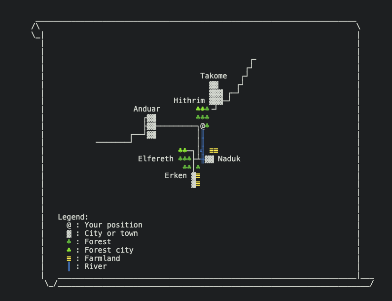
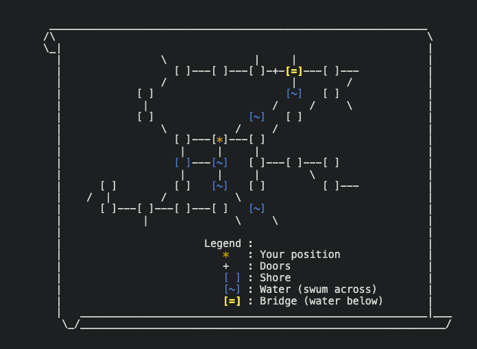

[Hexagon](https://github.com/maldorne/hexagon) has water now: rivers, lakes, the sea, underground streams. You swim them instead of walking, the current carries off whatever stops swimming, and a river can have a bridge over it. The first rivers are in [Reinos de Leyenda: Aeternum](/games/#Hexagon), one of the games built on Hexagon.

The rules come from the system of oceans and seas I wrote for [Ciudad Capital](/games/#Ciudad-Capital-v1) in 2009, ported and extended. They live in two shared files, `lib/room/water.c` and `lib/room/coast.c`. A game still made of rooms inherits them through the room bases `/lib/water.c` and `/lib/coast.c`. A game on [locations](/2025/01/23/from-rooms-to-locations-an-ecs-approach/) gets the same rules from the `water` and `coast` components, and converting a room to a location attaches the component with the room's own settings, so rooms and locations run the same code.



<!-- more -->

## Water and coasts

A water location says which way the water flows, how hard, and what happens to a swimmer going against it:

```lpc
set_water_current(DIR_SOUTHEAST);        // the exit the water flows out by
set_water_strength(2);                   // 0 still .. 3 rapids
set_water_upstream(WATER_UPSTREAM_HARD); // free | hard | block
set_water_depth(2);                      // 1 surface, 2 deep
```

Its edges are coasts: a beach, a cliff, a port, a river bank. A coast declares its kind and nothing else.

The ways into, across and out of the water are swum exits. A swum exit belongs to the map and to the coordinate graph like any other, and the map draws water as `[~]`, but it is not listed with the exits and typing its direction does nothing. The path finder leaves it out unless whoever walks it can swim. Every exit of a water location is swum, and on a coast you mark the ones that go into the water with the `swim` option of `add_exit`.

## Swimming

Players get across with the `swim` skill, and anybody who reaches water or a coast learns it. From a coast, `swim` on its own goes into the water. Once you are in, the location shows no exit lines. It says where the shore is and every way you can swim:

```
> swim south
~ You start swimming.
You manage to swim towards the south.

You can see the shore towards the west. You can swim towards the north, the south and the west.
```

Going in from a coast always works. Every stroke after that is rolled: 50 plus the swimmer's ability, 20 more going with the current, 5 less per point of strength going across it. Against a `hard` current the penalty is 10 per point of strength plus one, and nobody swims against a `block` one. Deep water costs another 10, and so does every point of load beyond half of what the swimmer can carry.

Whoever fails a stroke swallows water and loses a bite of life, never the last of it, and the current takes them downstream. Whoever stays in moving water without swimming is carried off after twenty seconds anyway. That is the easy way down a river:

```
You let yourself go and the current sweeps you away.
```

Then the next location, and twenty seconds later the next one.

## What the current carries

Each drag also rolls a chance of 10, plus 10 per point of strength, minus a tenth of the swim ability, of being thrown against the rocks. The damage is a d6 per point of strength plus 3% of the victim's maximum life per point:

```
The current batters you against the rocks and drags you under.
```

It can kill, and the death happens in the water: the ghost stays where it died, and the current drags ghosts too. A ghost cannot swim, but it walks the swum exits by typing the direction, as a spirit.

Items go the same way. Anything that is not a living and can be picked up is carried off when it lies in a location with a current. Each location keeps a single call_out, armed when the first item arrives, and moves everything that arrived by then in one pass. Items dropped together reach the next location together. On every drag each item rolls once:

- 15% of the time it is lost for good, unless it is or holds a unique item, which the water never takes;
- another 25% of the time, if that location has a swum exit to a coast, it is washed onto that shore;
- otherwise it goes on downstream and is queued again there.

Someone who dies in the water leaves the gear out of the corpse, money and worn items included, and each piece drifts on its own, like the corpse, so your clothes, your armour or anything else you carried can end up on a bank further down, or be lost for good.

NPCs keep out of the water unless their template says `swims`. A fish walks the swum exits and finds paths through them, and it is the only kind of NPC an area places in a water location.

## Bridges

A bridge is one location at one coordinate that is land and water at once. It carries every water setting, plus exits of type `bridge`, which are walked. Its other exits are swum, except a road across it, which stays a road.

Each living in that location is in one of two positions, on the bridge or in the water. You arrive on the bridge, unless you came in through a swum exit or were put in the water by a jump or a fall. On the bridge nothing drifts and only the bridge exits work. In the water the location reads like any other water: the shore line, the swim directions, the drift. `jump` drops you off the bridge into the river, and while you are in the water under a bridge you can reach, the location says so:

```
> jump into the river
You jump from the bridge into the water.

You can swim towards the northeast and the south. You are passing under a bridge, try to 'climb'.
```

`climb` gets you back up with a climb roll, which gets harder the stronger the current.

A bridge can be too high (`set_bridge_reachable(0)`). Then there is no climbing up, and no fighting between the two positions either: the attack command and aggressive NPCs both ask the location `query_out_of_reach(attacker, victim)` before a fight starts. On a low bridge someone on the deck and someone in the water can fight each other.

In a room it is one more base and one more exit type:

```lpc
inherit "/lib/bridge.c";

set_water_current(DIR_SOUTH);
set_water_strength(1);
add_exit(DIR_EAST, <bank>, "bridge");     // walked
add_exit(DIR_NORTH, <water>, "standard"); // swum, as in any water
```

A location needs only the `bridge` component, in place of the water one. Other code asks `query_in_water(who)` of the location, and can drop somebody through a breaking plank with `drop_into_water()`.

## On the maps

The local map marks both kinds of cell, and its legend says what they are. This is the abandoned bridge over the Anduin, in the Orgoth forest:



On the world map rivers are drawn per sector, the way roads are, in blue box lines, as in the map at the top of this post. A sector records the swum exits of every water location with a current in it, and a line is drawn only between two water locations; still water, with no current, draws no line. Where a straight road crosses a straight river in the same sector, the map shows a crossing glyph.

The source code is in the [Hexagon repository](https://github.com/maldorne/hexagon).
