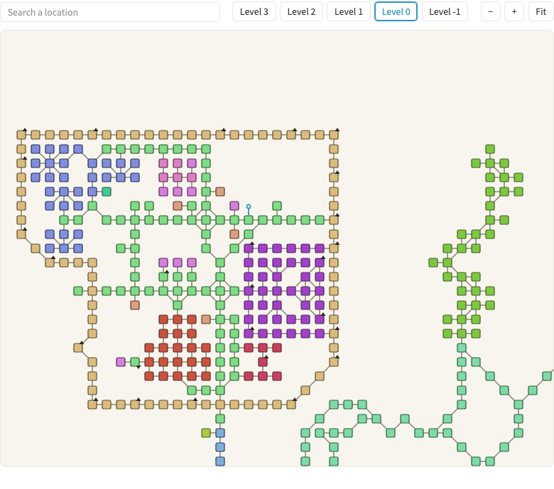
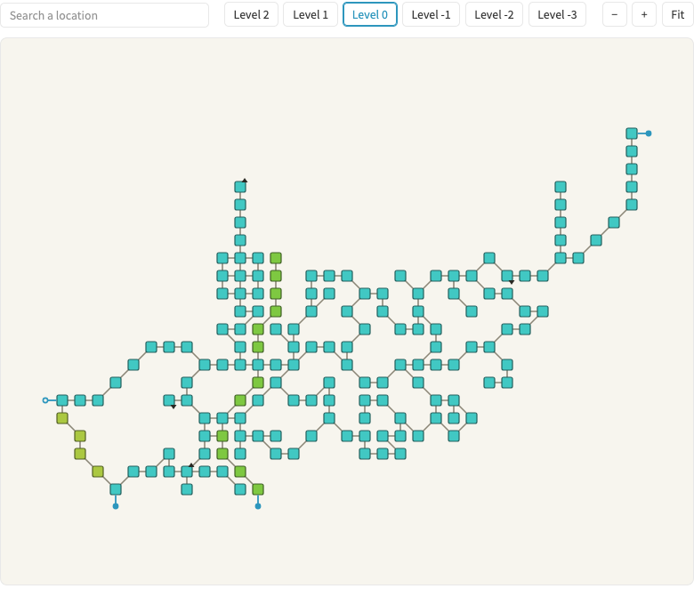

[maldorne.org](/) now has [maps of the game world](/maps/rl/): seven maps of [Reinos de Leyenda: Aeternum](/games/#Hexagon), in Spanish like the game. New players can use them to find their way, and the documentation I still have to write will link straight to places on them.

Takome, one of the main cities of [Reinos de Leyenda: Aeternum](/games/#Hexagon), with each group of locations in its own colour.
{.caption}

<!-- more -->

The maps are drawn from the game itself by [`mapper`](https://github.com/maldorne/hexagon/tree/master/mudlib/packages/mapper), a new optional package for the Hexagon mudlib. One admin command maps an area and its sub-areas into a JSON file.

That file holds only what a player could know: no NPCs, items or file paths. Locations that share zones share a colour, and the file never says which zones they are.

The viewer has levels, zoom and search. Every location has its own link, so pages can point at a place, and an exit to another area opens the neighbouring map.

The Orgoth forest in [Reinos de Leyenda: Aeternum](/games/#Hexagon), crossed by a river and a road.
{.caption}

The [mapper package](https://github.com/maldorne/hexagon/tree/master/mudlib/packages/mapper) is in the Hexagon repository, and the [viewer](https://github.com/neverbot/maldorne-theme/blob/master/source/js/mapper.js) and its [page generator](https://github.com/maldorne/maldorne.org/blob/master/web/scripts/maps.js) are in the code of this site.
